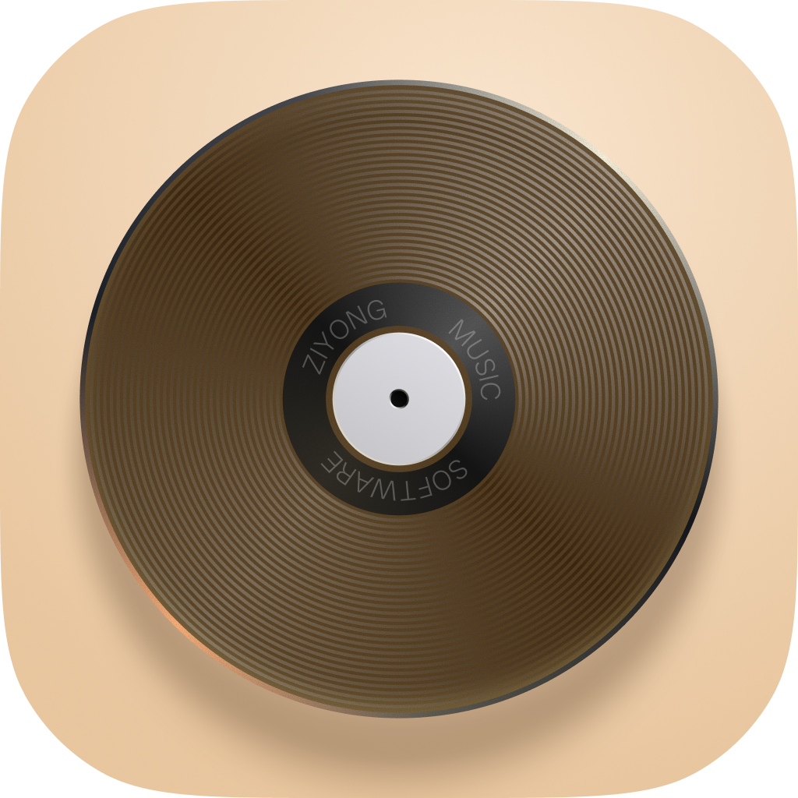

# 自用MUSIC

自用MUSIC 是用 Go 和 MyGo 编写的第三方网易云音乐桌面客户端。用手机扫码，就能在电脑上听每日推荐、整理歌单、跟着逐字歌词唱歌，也可以给播客生成本机字幕。

**当前版本 2.0.1** · [更新日志](CHANGELOG.md) · [从源码运行](#从源码运行) · [问题反馈](https://github.com/luisrock98/ziyong-music/issues)

## 2.0.1 里怎么找歌

- **首页**集中展示推荐歌单、每日推荐、私人 FM、新专速递和排行榜。「为你推荐的艺人」来自当天推荐歌曲的演唱者，点头像就能继续听这位艺人的作品。
- **发现**里可以按语种、风格或场景浏览歌单。打开「更多分类 → 编辑常用分类」，就能把常听的「爵士」「学习」等分类固定到顶部。
- **音乐库**汇集了你喜欢的歌曲、创建或收藏的歌单、收藏的专辑和关注的艺人。打开一张专辑，点详情页的封面即可播放。
- **搜索**可以先看综合结果，再按单曲、歌手、专辑、歌单、用户或播客细找。输入时有搜索建议，下次也能从历史记录继续。

## 播放与播客

打开「正在播放」可以看逐字歌词和翻译，切到「舞台」看动态歌词，或拖动「照片墙」、点一张封面播放队列里的歌。切回待播清单可以查看接下来播放的曲目。

播放器支持边下边播、本机缓存、音量均衡和退出后续播。音质可选标准至无损 FLAC、Hi-Res，实际可播放的歌曲和音质取决于网易云账号权限。macOS 用户还可以在设置中开启刘海播放器，将指针移到屏幕顶部即可展开。

播客支持订阅和逐句字幕。首次使用字幕时按提示下载约 1 GB 的模型和运行库，之后在本机边播边转写。点一句字幕就能跳到对应位置。

## 从源码运行

安装 Git 和 Go 1.27.3 或更新版本，在终端执行以下命令。桌面界面由 MyGo 原生绘制，构建只需 Go 工具链。

```bash
git clone https://github.com/luisrock98/ziyong-music.git
cd ziyong-music
go mod download
go tool mygo dev
```

打开后，点右上角账户图标，用手机网易云音乐扫码确认。登录后点「音乐库」查看自己的收藏，应用版本显示在「设置」标题旁。

在 macOS 13 或更新版本上，可将源码打包成可双击的应用：

```bash
go tool mygo build -skip-dmg
```

Apple Silicon 的输出是 `build/darwin-arm64/自用MUSIC.app`，Intel Mac 的输出在 `build/darwin-amd64/`。macOS 本地包采用临时签名，更新需手动重新构建。当前已在 Apple Silicon 上验证打包。Windows、Linux 的构建目标和维护者生成安装包的步骤见[构建与发布说明](RELEASING.md)。

## 数据与账号

登录、搜索和播放使用网易云音乐服务。打包版本将登录态保存在系统凭据存储中，开发模式使用应用用户目录下的私有 `session` 文件。设置、播放队列和歌曲缓存均保存在本机。播客模型来自 ModelScope 或 Hugging Face，运行库来自上游 GitHub Releases。

## 参与开发

```bash
go test ./internal/...
CGO_ENABLED=0 go test ./...
go tool mygo vet .
```

提交问题时，请注明应用版本、操作系统和复现步骤。测试约定与提交建议见[贡献指南](CONTRIBUTING.md)。

## 项目来源与致谢

本项目基于 [egoist/mygo-cloudmusic](https://github.com/egoist/mygo-cloudmusic)，从 [Amamiya23/mygo-qyin 的网易云版本 `5703a7a`](https://github.com/Amamiya23/mygo-qyin/tree/5703a7a90a8e502d4de185855970620228a58679) 继续开发，保留原项目的提交历史和 AGPL-3.0 许可证。

- [YesPlayMusic](https://github.com/qier222/YesPlayMusic)：经典版界面布局和视觉设计的参考
- [MyGo](https://github.com/egoist/mygo)：原生 UI 与应用框架
- [NeteaseCloudMusicApi](https://github.com/Binaryify/NeteaseCloudMusicApi)：eapi 加密与登录流程的参考
- [folia-major](https://github.com/chthollyphile/folia-major)：歌词动画效果的参考
- [sherpa-onnx](https://github.com/k2-fsa/sherpa-onnx)、[Qwen3-ASR](https://github.com/QwenLM/Qwen3-ASR) 与 [Silero VAD](https://github.com/snakers4/silero-vad)：本机语音识别

本项目与网易云音乐官方无关，音乐版权归各权利人所有。

## 许可证

[AGPL-3.0](LICENSE)
